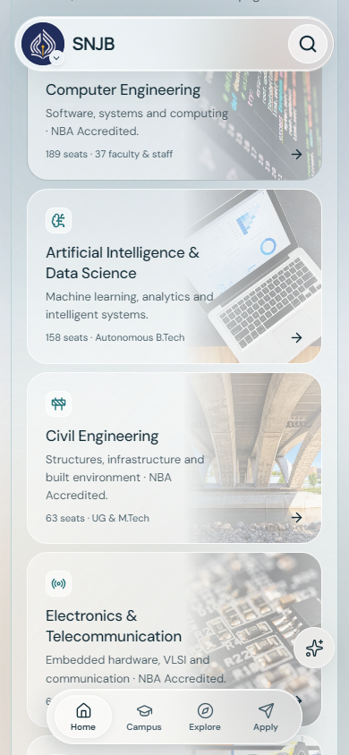
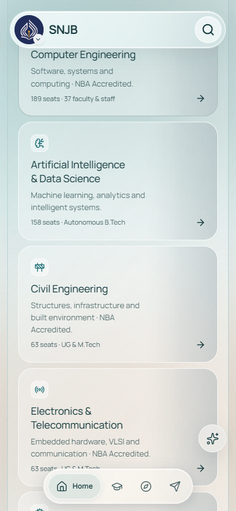

# Before and after — programme photography and phone navigation

The before image is a real 390 × 844 Edge capture from the preserved supplied source, before Elevate edits. The after image is a real capture at the same viewport in light mode. These are not generated mockups. Scroll positions differ slightly because the introductory copy was corrected.

| Supplied baseline | Updated UI |
| --- | --- |
|  |  |

What changed: the stacked white image wash is removed; one mask blends rich photography into the glass. The dock has only one labelled active tab, horizontally aligned with its icon. Card structure and original destinations remain intact.

Additional rendered Home, department, Apply, Explore and Audit evidence is kept locally in ignored qa/elevate/. Original before captures and the complete baseline archive remain in D:/SNJB/.research/elevate-20261016/.
